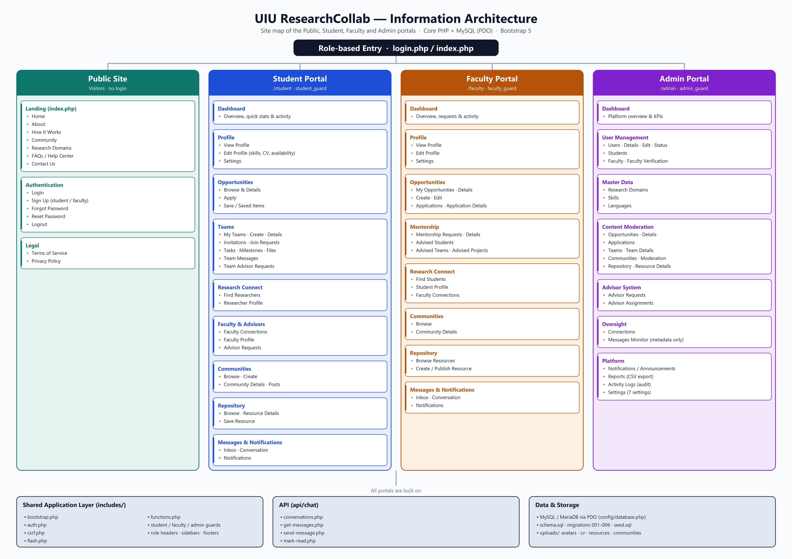
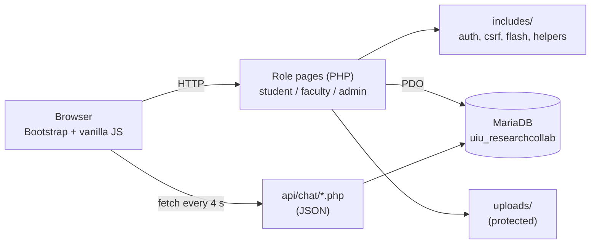

<p align="center">
  
</p>

<h1 align="center">UIU ResearchCollab</h1>

<p align="center">
  <b>Connecting Minds. Creating Research.</b><br>
  A role-based research-collaboration portal for students, faculty and administrators of<br>
  United International University (UIU), built with Core PHP and MySQL.
</p>

<p align="center">
  
  
  
  
  
  
</p>

---

## Table of Contents

1. [About the project](#about-the-project)
2. [Portals and features](#portals-and-features)
3. [Smart matching](#smart-matching)
4. [Tech stack](#tech-stack)
5. [Architecture](#architecture)
6. [Project structure](#project-structure)
7. [Database](#database)
8. [Getting started](#getting-started)
9. [Security](#security)
10. [Known limitations and roadmap](#known-limitations-and-roadmap)
11. [Documentation](#documentation)
12. [Authors and credits](#authors-and-credits)

---

## About the project

Research at a university often happens by chance: students do not know who shares their interests, faculty
opportunities are announced informally, project supervision is arranged through personal contacts, and nothing records
collaboration history.

**UIU ResearchCollab** gives the community one place to:

- **discover** researchers and opportunities with a compatibility score,
- **team up** in private team workspaces (tasks, milestones, files, messages),
- **get mentored** through a structured faculty-advisor workflow,
- **share knowledge** in communities and a research repository,
- **govern** everything from an admin portal with moderation, audit log, reports and settings.

The project has **127 PHP files** (about 22,000 lines), **57 database tables** and three portals. It is written
without a framework on purpose: routing, authentication, CSRF protection, validation and PDO are implemented by hand
in a small shared `includes/` layer.

## Portals and features



| Portal | For | Highlights |
|---|---|---|
| **Public site** | Visitors | Landing page, about, how it works, research domains, FAQ, contact, sign-up (student / faculty), forgot and reset password |
| **Student portal** | Students | Profile with skills / domains / CV / privacy toggles, **Research Connect** directory with match scores, opportunities (apply, withdraw, save), **teams** with workspace, communities, repository, advisor requests, direct chat, notifications |
| **Faculty portal** | Faculty | Profile, opportunity creation and applicant review (shortlist / accept / reject), mentorship inbox, advised students and teams, connections, chat, communities, repository |
| **Admin portal** | Administrators | User management, faculty verification, master data, moderation of every module, advisor oversight, announcements, activity log, CSV reports, 7 live platform settings |

Other highlights:

- **Advisor workflow** with six request types, transactional acceptance, capacity checks and team advisors.
- **Direct chat** between students and faculty (JSON API, 4-second polling, unread badges).
- **Privacy by design** - visibility toggles, private communities, membership-gated team files, and an admin chat monitor that shows **metadata only**.

<!--
### Screenshots
Add your screenshots to docs/screenshots/ and uncomment the lines below.

| Landing page | Student dashboard |
|---|---|
|  |  |

| Research Connect | Admin dashboard |
|---|---|
|  |  |
-->

## Smart matching

Research Connect gives every candidate a **0-100 compatibility score** relative to the viewer:

| Factor | Weight |
|---|---|
| Shared research domains | 40 |
| Shared skills | 30 |
| Same department / program | 15 |
| Academic-level closeness | 10 |
| Both looking for a team | 5 |

## Tech stack

| Layer | Technology |
|---|---|
| Front end | HTML5, CSS3, Bootstrap 5.3.3, Bootstrap Icons, vanilla JavaScript |
| Back end | Core PHP 8 (no framework), PDO with prepared statements |
| Database | MariaDB 10.4 / MySQL, `utf8mb4`, InnoDB, foreign keys, CHECK constraints, generated columns |
| Server | Apache via XAMPP |
| PHP extensions | `pdo_mysql`, `mysqli`, `mbstring`, `fileinfo`, `curl`, `gd` |

## Architecture



## Project structure

```text
UIU-ResearchCollab-Research-Collaboration-Portal/
├── index.php, login.php, signup.php, faculty-signup.php, logout.php,
│   forgot-password.php, reset-password.php, contact.php, faq.php, terms.php, privacy.php   # public site
├── student/      # 34 student-portal pages
├── faculty/      # 25 faculty-portal pages
├── admin/        # 29 admin-portal pages
├── api/chat/     # 4 JSON endpoints used by both chat UIs
├── includes/     # auth, csrf, flash, 50+ helper functions, guards, headers, sidebars
├── config/       # database.php (PDO, XAMPP defaults)
├── database/     # schema.sql, 6 migrations, seed.sql + import guide
├── uploads/      # avatars, cv, resources, communities, team-files (contents git-ignored, protected)
├── CSS/, JS/, IMAGES/             # design system and assets
├── *.html                          # original static design mock-ups
└── docs/         # architecture diagrams, full documentation (PDF), development log
```

## Database

**`uiu_researchcollab`** - 57 tables: identity and settings, student and faculty profiles, master data, opportunities
and applications, teams, communities, repository, advisor requests and assignments, connections and direct messages.
It is created from `schema.sql`, six migrations and `seed.sql`. **See [`database/README.md`](database/README.md)
for the exact import order.**

## Getting started

### Prerequisites

- [XAMPP](https://www.apachefriends.org/) with **PHP 8+** - enable the `gd` extension in `php.ini`
  (`extension=gd`) and restart Apache
- [Git](https://git-scm.com/)

### 1. Clone into XAMPP's `htdocs`

```bash
git clone https://github.com/Rahil03-git/UIU-ResearchCollab-Research-Collaboration-Portal.git C:\xampp\htdocs\UIU-ResearchCollab
```

### 2. Start Apache and MySQL, then create the database

1. Open <http://localhost/phpmyadmin> and click **New**.
2. Create a database named **`uiu_researchcollab`** (collation `utf8mb4_unicode_ci`).
3. Import the SQL files **in the order shown in [`database/README.md`](database/README.md)**
   (`schema.sql`, the six migrations, then `seed.sql` once).

### 3. Check the connection settings

`config/database.php` uses the XAMPP defaults: `127.0.0.1`, user `root`, empty password. If your MySQL root password is
different, create `config/database.local.php` instead of editing the tracked file (it is git-ignored).

### 4. Open the site

<http://localhost/UIU-ResearchCollab/> - the base URL is detected automatically.

### Demo accounts (local development only)

| Role | E-mail | Password |
|---|---|---|
| Student | `student@example.com` | `Password123!` |
| Faculty | `faculty@example.com` | `Password123!` |
| Admin | `admin@example.com` | `Password123!` |

The seed also contains more students and faculty - see [`docs/DEVELOPMENT_LOG.md`](docs/DEVELOPMENT_LOG.md).
> **Never use these accounts on a public server.**

## Security

- PDO **prepared statements** everywhere (exceptions on, emulation off)
- **CSRF tokens** on every state-changing form and the chat API
- Passwords hashed with `password_hash`; reset tokens stored as SHA-256 hashes, single use, 1-hour expiry
- **Session re-validation** on every request - suspending a user logs them out immediately
- **Role guards** on every page plus ownership, membership and advisor checks in SQL
- Upload hardening: extension allow-list, size limits, random names, `.htaccess` blocking script execution and direct access to team files
- CSV export protected against formula injection

## Known limitations and roadmap

This is an academic project. Planned improvements:

- [ ] Send real e-mail (SMTP) - the password-reset link is currently shown on screen
- [ ] Row-lock the team-capacity check when a faculty accepts an advisor request
- [ ] Real-time chat for teams (WebSocket / SSE) instead of page refresh
- [ ] Automated tests (PHPUnit and browser smoke tests) and CI
- [ ] Calendar of meetings and deadlines, content reporting, analytics
- [ ] REST API, mobile app and UIU single sign-on

## Documentation

- Complete project report - architecture, database design, matching algorithm, security review, test cases and a viva
  guide: [`docs/UIU_ResearchCollab_Complete_Project_Documentation.pdf`](docs/UIU_ResearchCollab_Complete_Project_Documentation.pdf)
- Original README with dated development and test reports: [`docs/DEVELOPMENT_LOG.md`](docs/DEVELOPMENT_LOG.md)

## Authors and credits

Developed at **United International University (UIU), Dhaka**.

- **Abrar Adib** - [@AbrarAdib18](https://github.com/AbrarAdib18) - owner of the original repository and author of its commit history
- **Kazi Shibli Zaman Rahil** - [@Rahil03-git](https://github.com/Rahil03-git)

**Original repository:** [AbrarAdib18/UIU-Research-Collaborator-](https://github.com/AbrarAdib18/UIU-Research-Collaborator-)

<!-- Add more teammates, for example:
- **Name** - role - [@github-username](https://github.com/github-username)
-->

---

<p align="center">Built with Core PHP, MySQL and Bootstrap.</p>
